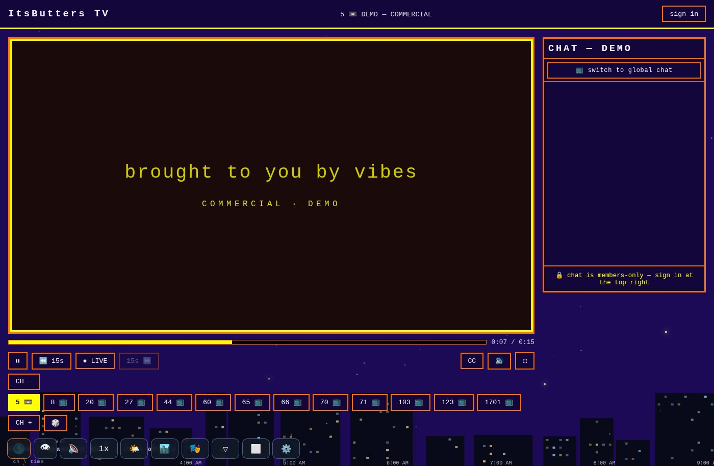
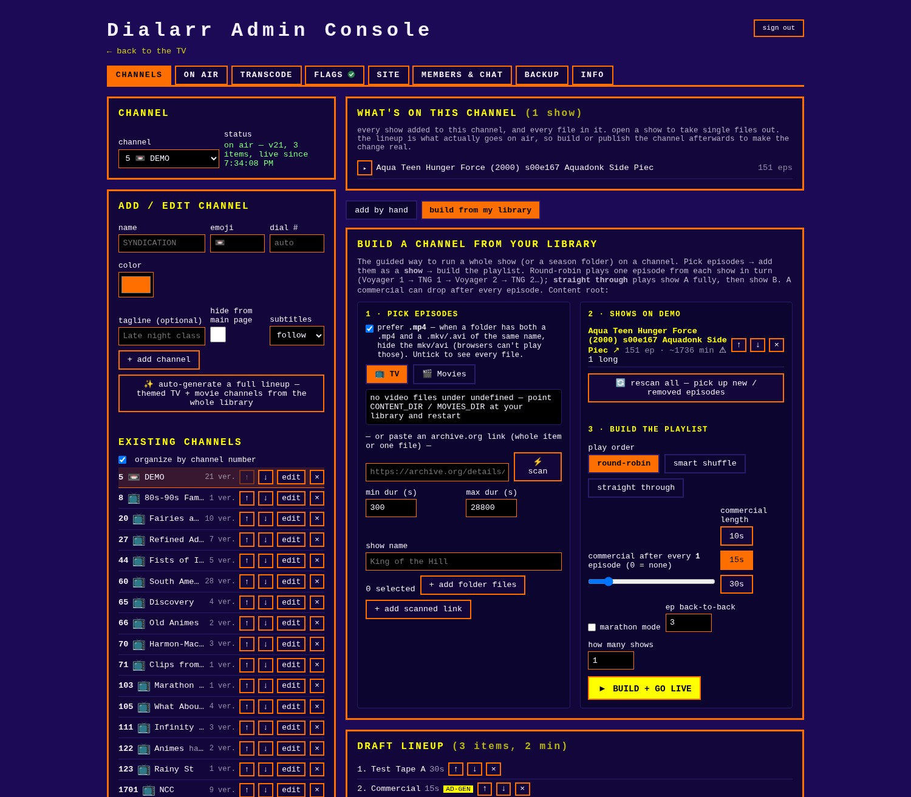
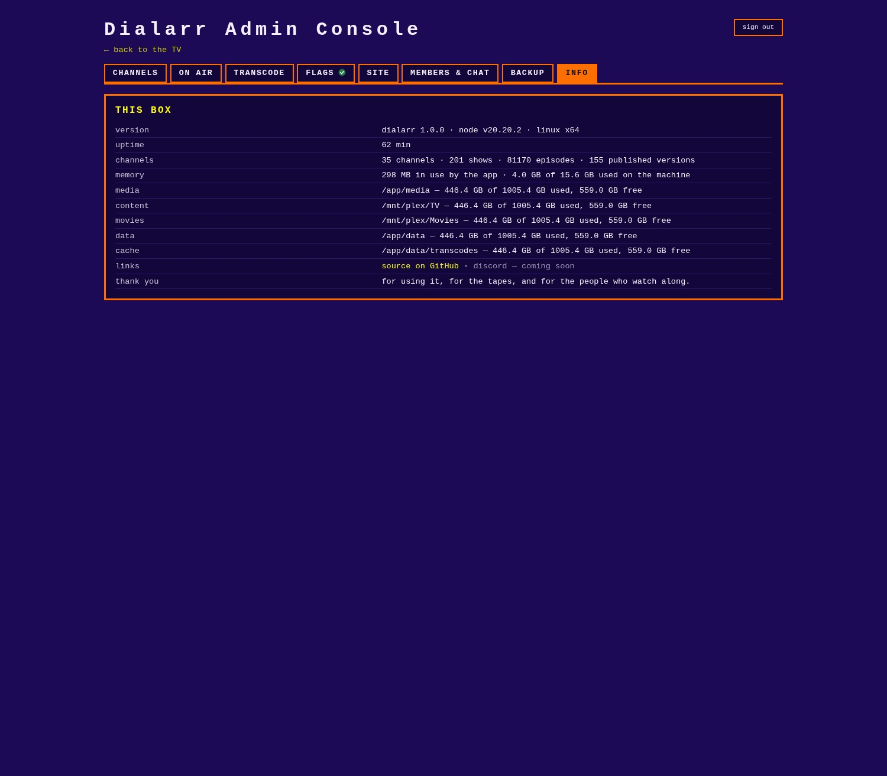
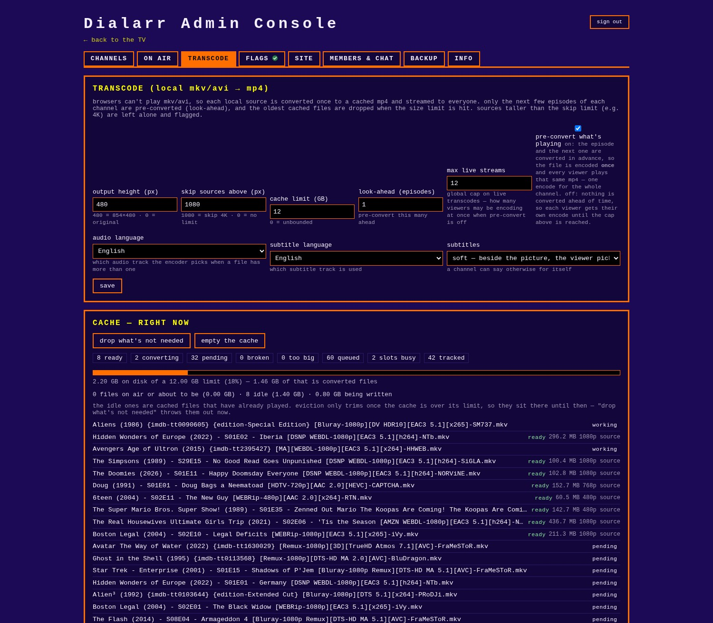

# Dialarr

**24/7 cable TV from your own tapes.**



A live one is running at [itsbutters.uk](https://itsbutters.uk/).

## What this is

There is no live stream. Every channel is a playlist looping from a fixed
timestamp, and each viewer's browser works out what is playing from its own
clock — so a hundred people watching are in sync, and there is nothing to
synchronise.

That is the whole trick. The rest is a channel dial, a programme guide, chat,
commercials, and an admin console for building the channels.

In practice:

- **Your own files, as a broadcast.** Point it at a disk, or at archive.org.
  The files become channels that never stop.
- **One encode per channel, not per viewer.** Whatever the browser cannot
  play is converted once and cached, and everybody watching that channel
  shares the one file.
- **A guide that is right on every screen.** It is not sent to anyone — it is
  worked out from the clock.
- **An admin console.** Eight tabs, in the order you work in them.

## How to set it up

```bash
git clone https://github.com/200plat/dialarr
cd dialarr
cp .env.example .env      # then put a password in it
docker compose up -d --build
```

- the TV: <http://localhost:3005>
- the admin console: <http://localhost:3005/admin.html>

Without Docker:

```bash
npm install
npm start
```

A fresh clone has no `data/` — the server seeds it from `sample/`, so you get a
working channel with a test pattern and some commercials on it before you have
added anything of your own.

### Your library

Point it at a directory and browse it from the admin console:

```bash
CONTENT_DIR=/mnt/plex/TV
MOVIES_DIR=/mnt/plex/Movies
```

Both are optional and default to `./media`. Symlinks work as well as real
files. Content does not have to be local either — an item can be any URL, and
archive.org's download links work well.

### Building a channel

A channel is made of shows, a show is made of episodes, and an episode is a
title, a file and a length.

```
data/lineup.json              the channels, and which version of each is on air
data/manifests/<ch>/v1.json   the items of that channel, in order
```

In the console, pick a channel and build it on the right-hand side: browse the
library and add whole folders as shows, add single items by hand with a length
you type or one it measures, add generated commercials, then publish. The draft
belongs to the channel, so switching away and back does not lose it — and
inside a show you can open it and take single files out.

Publishing a channel writes its playlist to `data/manifests/` and stamps the
moment the loop began. From then on the playlist repeats forever, and the guide
is just arithmetic: where are we in the loop, given the time?

A commercial is just an item flagged as one. It can be a real video file, or a
generated one: an on-screen card with a few lines of text and some music, for
the gaps where your tapes have nothing to sell you.

### The settings

Everything is in `.env`; see `.env.example` for the full list with defaults.

| Variable | What it does |
|---|---|
| `ADMIN_PASSWORD` | Password for the admin console |
| `PORT` | Port to listen on (default 3005) |
| `CONTENT_DIR` / `MOVIES_DIR` | Where your library is |
| `PROBE_TIMEOUT` | How long to wait when measuring a file |
| `TC_BAD_RETRY_MS` | How long a failed conversion waits before retrying |

## What to expect

### The picture starts straight away

Any video the browser cannot play (mkv, avi, mpeg, ts…) is converted to mp4 on
the server and the converted file is cached, so it is served to everybody rather
than converted per viewer. The conversion happens ahead of time for whatever is
about to air, which is why a stream starts instantly instead of after a minute
of silence.

If the picture is not ready yet, the file is encoded live — once for the
channel, with everybody watching sharing that one encode. A hundred viewers of
a channel is still one ffmpeg, so a box can carry a lot of channels at once.

While the picture is coming up, the set shows a tuning screen rather than a
black rectangle — static, and *PLEASE STAND BY*.

The first build takes a while, because it has to build up the cache. If all the
files are mp4, whether they're on your own drive or coming from archive.org,
you'll probably only use up 50MB of ram.

### The console



Behind `ADMIN_PASSWORD` (set it in `.env`; without it the console is open to
anyone who can reach it). It is eight tabs, in the order you work in them:

| Tab | What it is for |
|---|---|
| **Channels** | the channel list on the left, and everything about the one you picked on the right: its shows, its files, its draft, and what it is on air |
| **On air** | every channel at once — what is playing, what is next, and the controls to shift or skip the whole broadcast |
| **Transcode** | how the cache is set up, what it is doing right now, and the languages it picks |
| **Flags** | every file the cache has given up on, with the reason, and the ways to fix it |
| **Site** | the site name, the site password, the theme, and the four boxes at the bottom of the TV page |
| **Members & Chat** | who may chat, the chat effects, and the members — add them, reset a password, and the names nobody may have |
| **Backup** | back up, export, and move the whole thing to another machine |
| **Info** | version, uptime, memory, and what is mounted and how full it is |



The **Flags** tab is the one that earns its keep. When a file cannot be read,
the cache gives up on it and says why — *probe timed out*, *no video stream*,
*file not found on disk*. The tab lists every one of them across every channel,
and **fix** takes the file out of the queue, out of the cache and out of the
show, keeping a record of why it went. The tab carries a red triangle while
anything is outstanding and a green tick when there is nothing wrong.

### Languages

An mkv often carries several languages of audio and subtitles, and the
**Transcode** tab is where you say which ones you want.



- **Audio language** — the track the encoder picks when a file has more than
  one. English by default; pick Spanish for a channel that is watched in Spain.
- **Subtitle language** — the subtitle track that is used. It is the default
  for everybody, and a viewer can still pick another one for themselves.
- **Subtitles** — *soft* means the subtitles ride beside the picture and the
  viewer turns them on; *hard* means the encoder burns them into the picture
  as it converts, so they are there for everybody and nobody has to switch
  them on; *off* means none.

Any channel can do the opposite of the site setting — the anime channel is
always hard, or always soft, whatever the rest of the site does.

Picture subtitles (PGS, VobSub) are pictures rather than text, so they cannot
be burned in; they are skipped.

The TV page tells you what it is playing: open the **CC** panel and it says
which audio track was picked and why — *English (AC3 Stereo)*, *AC-3 2.0
[DVD]*, *Japanese 2.0* — so you can see that the right one is the one you are
hearing. Commentary tracks are never played: the programme is.

## Development

```bash
npm test
```

Nine suites: the clock maths, duration probing, the live stream, the reconnect
loop that once took a box down, the page weight, the pre-convert queue, the
audio/subtitle tracks, the languages and the subtitle burn, and the footer
boxes.

## Ideas

[IDEAS.md](IDEAS.md) has the next few: a channel that picks up new episodes on
its own and forgets anything older than a week, a real library that knows what a
show is instead of a folder of files, and commercials written for the show rather
than for the channel. None of it is built yet, and the file says why.

## Buy me a coffee

This is a weekend project and it runs on whatever box you have. If it saves you
an evening of wiring up a media server, a coffee would be lovely.

- [ko-fi.com/itsbuttersuk](https://ko-fi.com/itsbuttersuk)
- [patreon.com/ItsButters](https://patreon.com/ItsButters)

Your own TV page can say so too: the **Site** tab of the console takes a coffee
link and a Patreon link, and the **☕ buy me a coffee** button appears at the
bottom of the page when one is set.

## Licence

[PolyForm Noncommercial](LICENSE) — free for personal and non-commercial use.
Get in touch before using it commercially.
